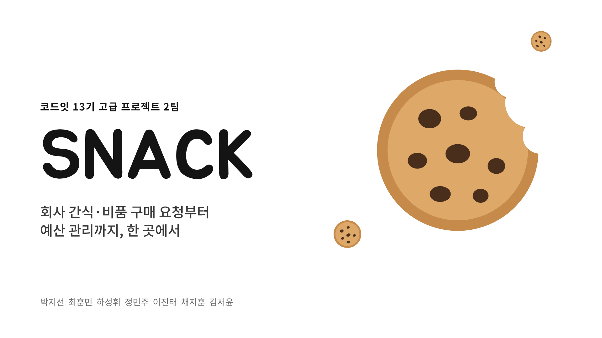
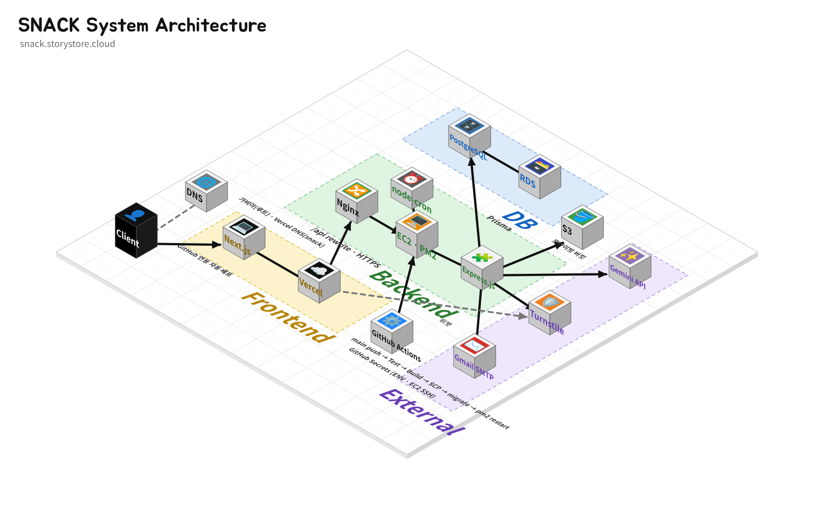

# 🍪 SNACK(스낵) - 원스톱 구매 관리 서비스

<p align="center">
  
</p>

### 🔗 [배포 사이트 바로가기](https://snack.storystore.cloud/)

### 🔗 [Front-end Repository 바로가기](https://github.com/myfunnyhome/13-2-snack-fe)

<br/>

## 📚 목차

1. [프로젝트 소개](#-프로젝트-소개)
2. [기능 구현 영상](#-기능-구현-영상)
3. [시스템 아키텍처](#-시스템-아키텍처)
4. [기술 스택](#-기술-스택)
5. [팀원 소개 및 문서](#-팀원-소개-및-문서)
6. [개인별 주요 작업](#-개인별-주요-작업)
7. [프로젝트 구조](#-프로젝트-구조)
8. [주요 기능](#-주요-기능)

<br/>

## 📑 프로젝트 소개

> **간식 대장, SNACK**
>
> 흩어져 있던 회사 간식·비품 구매를 **요청 → 승인 → 예산 관리** 하나의 흐름으로 묶은 원스톱 구매 관리 서비스입니다.

- **프로젝트 기간**: 2026.08.26 ~ 2026.10.16
- **API 문서 (Swagger)**: [바로가기](https://api.snack.storystore.cloud/docs)

<br/>
 
### 🔑 테스트 계정

> 추후 로그인 화면에서 역할별 **게스트 모드**로 바로 둘러볼 수 있도록 개선할 예정입니다.

<br/>

## 📱 기능 구현 영상

<p align="center">
  <a href="https://youtu.be/bOVqdiB5-zQ">
    
  </a>
</p>

> 이미지를 클릭하면 유튜브에서 영상이 재생됩니다. ([바로가기](https://youtu.be/bOVqdiB5-zQ))

<br/>

## 🧱 시스템 아키텍처

[](./docs/readme/architecture.png)

<br/>

## 🧰 기술 스택

<!-- 기술 스택 이미지를 넣으려면 아래 주석을 풀고 파일을 ./docs/readme/tech-stack.png 에 올려 주세요
<p align="center">
  
</p>
-->

### ✔️ Framework & Language

  

### ✔️ Database & ORM

 

### ✔️ Auth & Security

    

### ✔️ Infra & Utility

    

### ✔️ AI


### ✔️ Test & Docs

    

### ✔️ Hosting & CI/CD

    

### ✔️ Collaboration

  

<br/>

## 👨‍👩‍👧‍👦 팀원 소개 및 문서

### 팀원 소개

|                                                        팀장 (FS)                                                         |                                                         BE Dev                                                         |                                                       부팀장 (FS)                                                        |                                                             FS Dev                                                             |
| :----------------------------------------------------------------------------------------------------------------------: | :--------------------------------------------------------------------------------------------------------------------: | :----------------------------------------------------------------------------------------------------------------------: | :----------------------------------------------------------------------------------------------------------------------------: |
| [](https://github.com/myfunnyhome)<br/>**🦖 박지선** | [](https://github.com/choihoomba)<br/>**🐧 최훈민** | [](https://github.com/seonghwi-ha)<br/>**💨 하성휘** | [](https://github.com/quothraven1122)<br/>**🦴 정민주** |

|                                                      FS Dev                                                      |                                                         FS Dev                                                         |                                                        FE Dev                                                        |
| :--------------------------------------------------------------------------------------------------------------: | :--------------------------------------------------------------------------------------------------------------------: | :------------------------------------------------------------------------------------------------------------------: |
| [](https://github.com/jeantae)<br/>**🐯 이진태** | [](https://github.com/jihun-chae)<br/>**🙉 채지훈** | [](https://github.com/seoyoon-k)<br/>**🐼 김서윤** |

### 팀 문서

- [📒 팀 노션 바로가기](https://fringe-door-8de.notion.site/44c72db1b23082b8a0d8015a1d11aa18?v=4a572db1b230835086f788cfc568800f)

### 협업 방식

- **데일리 스크럼**: 매일 진행 상황과 막힌 부분 공유
- **페어 리뷰**: 2인 1조로 서로의 PR을 확인하고 리뷰
- **브랜치 전략**: Merge 권한은 팀장·부팀장, `dev`로는 Squash merge, `dev → main`은 Merge
- **GitHub Projects**: 이슈와 작업 진행 상태를 한 보드에서 관리

<br/>

## 🧑‍💻 개인별 주요 작업

<details>
<summary><b>🦖 박지선</b></summary>

- Auth
- User
- Invitations
- Snacky (AI 어시스턴트)
- AWS EC2·Nginx·PM2·RDS·S3 배포
- 도메인 HTTPS
- GitHub Actions CI/CD
- Turnstile
- Trust proxy
- 보안 점검

</details>

<details>
<summary><b>🐧 최훈민</b></summary>

- Auth
- User
- Invitation
- Order
- Swagger

</details>

<details>
<summary><b>💨 하성휘</b></summary>

- 커스텀 에러 클래스·전역 에러 핸들러
- 상품 API (목록·상세·등록·수정·삭제)
- 상품 이미지 API (S3 업로드·조회·삭제)
- 상품 응답 확장 (isMine, wishlistCount, productUrl)
- 시드 데이터 정리

</details>

<details>
<summary><b>🦴 정민주</b></summary>

- Budget API
- node-cron 월 예산 자동 생성 + fail-safe 로직

</details>

<details>
<summary><b>🐯 이진태</b></summary>

- Prisma seed 데이터
- 장바구니 API (조회·담기·수량 수정·삭제)

</details>

<details>
<summary><b>🙉 채지훈</b></summary>

- 상품 리스트 조회 API
- 찜 목록 API

</details>

<br/>

## 📂 프로젝트 구조

```
13-2-snack-be/
├── prisma/              # schema.prisma, migrations/, seed.ts, seedCatalog.ts
├── snacky/              # RAG 데이터: guides/ · chunks/ · embeddings/
├── .github/workflows/   # deploy.yml (CI/CD)
└── src/
    ├── app.ts, server.ts
    ├── config/          # prisma, s3, gemini, swagger
    ├── docs/            # *.swagger.ts
    ├── middlewares/     # auth, errorHandler, rateLimiter, signinTurnstileLimiter,
    │                    # snackyRateLimiter, turnstile, upload
    ├── modules/         # auth, budgets, cartItem, image, invitation, order,
    │                    # product, snacky, user, wishlist
    │                    # (controller / service / repository / schema)
    ├── routes/          # *.route.ts, me/, admin/, super-admin/
    ├── schedulers/      # budget.scheduler.ts
    ├── scripts/snacky/  # chunk, embed, search, answer
    ├── types/
    └── utils/
```

<br/>

## ✨ 주요 기능

### 기능 소개

**회원가입 및 로그인**

- 초대 이메일을 통해 회원가입을 진행하고, 이메일과 비밀번호를 이용해 로그인

**상품 조회 및 관리**

- 등록된 간식 상품을 카테고리와 정렬 기준에 따라 조회하고, 상품을 등록 및 관리

**장바구니**

- 구매할 상품을 선택하고 삭제하며, 선택한 상품의 총 주문 금액을 확인

**간식 구매 요청**

- 장바구니를 통해 간식 구매를 요청하고, 구매 요청의 상태 및 상세 내역을 확인

**구매 내역 관리**

- 내가 요청하거나 구매한 간식 내역을 조회하고, 구매 요청을 취소

**구매 요청 관리**

- 관리자가 전체 구매 요청을 조회하고, 구매 요청을 승인하거나 반려

**예산 및 지출 관리**

- 조직 전체의 구매 지출액과 예산을 조회하고, 최고 관리자가 월별 예산을 관리

**회원 관리**

- 최고 관리자가 회원을 조회하고, 이메일 초대 및 회원 권한 변경 등을 관리

**프로필 관리**

- 기업명, 이름, 이메일, 권한 등 내 정보를 확인하고 비밀번호를 변경

### 역할별 권한

| 역할                      | 주요 기능                                                           |
| ------------------------- | ------------------------------------------------------------------- |
| 일반 사용자 (GENERAL)     | 상품 조회·등록, 찜하기, 장바구니, 구매 요청 및 내역 확인            |
| 관리자 (ADMIN)            | 구매 요청 승인·반려, 즉시 구매 (예산에서 바로 차감), 예산 현황 확인 |
| 최고 관리자 (SUPER_ADMIN) | 회원 초대·권한 변경·삭제, 월 예산 설정, 조직명 변경                 |

- 라우트 단위: `/admin/*`은 ADMIN 이상, `/super-admin/*`은 SUPER_ADMIN만 접근
- 서비스 단위: 상품 수정·삭제는 등록자 또는 ADMIN 이상, SUPER_ADMIN 대상 권한 변경 불가

### 🚀 심화 기능

**1. 찜하기**

- 찜 목록 조회·추가·해제·일괄 해제 API
- 상품 응답에 찜 개수(`wishlistCount`) 포함, 같은 상품 중복 찜은 DB unique로 방지

**2. 회원 초대 메일**

- Nodemailer(Gmail)로 초대 링크 발송, 유효기간 7일
- 토큰은 SHA-256 해시로만 저장, 다시 초대하면 이전 초대는 만료
- 가입 시 초대 사용 처리를 트랜잭션으로 처리

**3. 비밀번호 찾기**

- 이메일로 재설정 링크 발송, 유효기간 30분
- 가입 여부와 관계없이 같은 응답을 보내 계정 존재 여부 노출 방지
- 재설정 후 토큰 삭제, `tokenVersion`을 올려 기존 로그인 무효화

**4. 매달 예산 자동 생성 (node-cron)**

- `0 0 1 * *` (Asia/Seoul): 매월 1일 00:00에 조직별 예산 생성
- **fail-safe**
  - 서버가 꺼져 있어 스케줄을 놓친 경우 → 서버 기동 시 보충 생성
  - 일시적 실패 → 재시도 (기동 시 3초 간격 3회, 크론 5분 간격 3회)
  - 중복 생성 → 조직·연·월 unique + upsert로 방지
  - 한 조직이 실패해도 나머지 조직은 계속 생성

**5. 봇 차단 (Cloudflare Turnstile + Rate Limit)**

- 로그인 실패가 반복되면 Turnstile 토큰을 요구하고, 서버에서 siteverify로 검증
- 로그인: IP 기준 15분 100회, 실패 누적 시(이메일+IP 3회, 이메일 5회) Turnstile 요구
- 회원가입 (초대 없는 최고 관리자 가입): IP 기준 1시간 10회
- 비밀번호 재설정 요청: IP 기준 1시간 5회
- Snacky: 사용자 기준 10분 10회
- **다음 단계**: 실제 사용자 IP 기준 카운트와 카운트 reset 구현

**6. Snacky (AI 어시스턴트)**

- 서비스 가이드 문서를 근거로 답하는 RAG 기반 어시스턴트
- 가이드 문서 → `##` 단위 Chunking → Gemini Embedding → 코사인 유사도 검색 → Gemini 답변
- 답변과 함께 참고한 문서 섹션(`sources`)을 반환
- **다음 단계**: 읽기 전용 Tool Calling, Vector DB 확장 등 추가 보완 기능을 통해 SNACK에 맞춘 어시스턴트로 고도화
